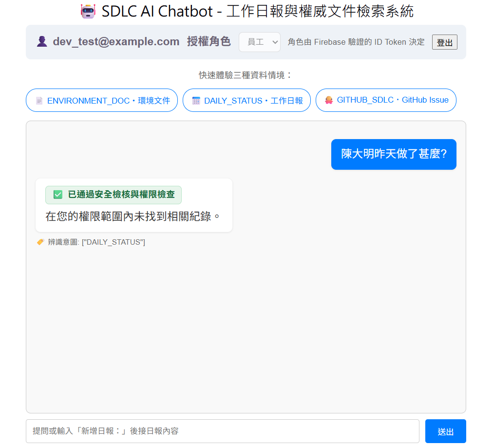
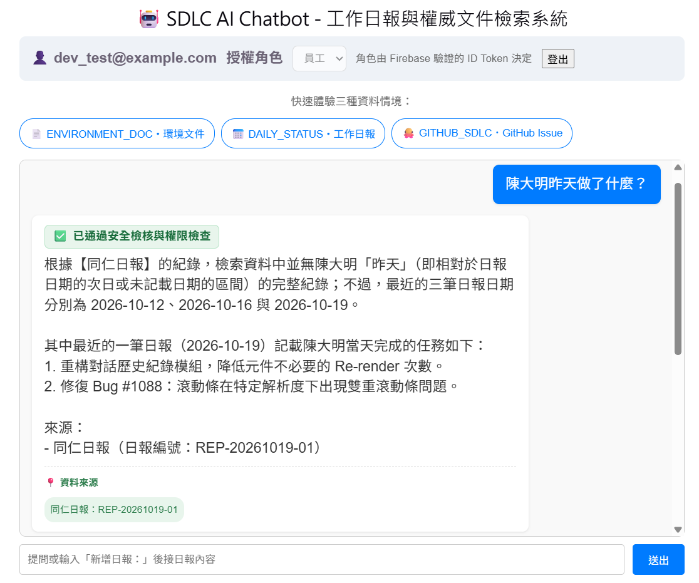
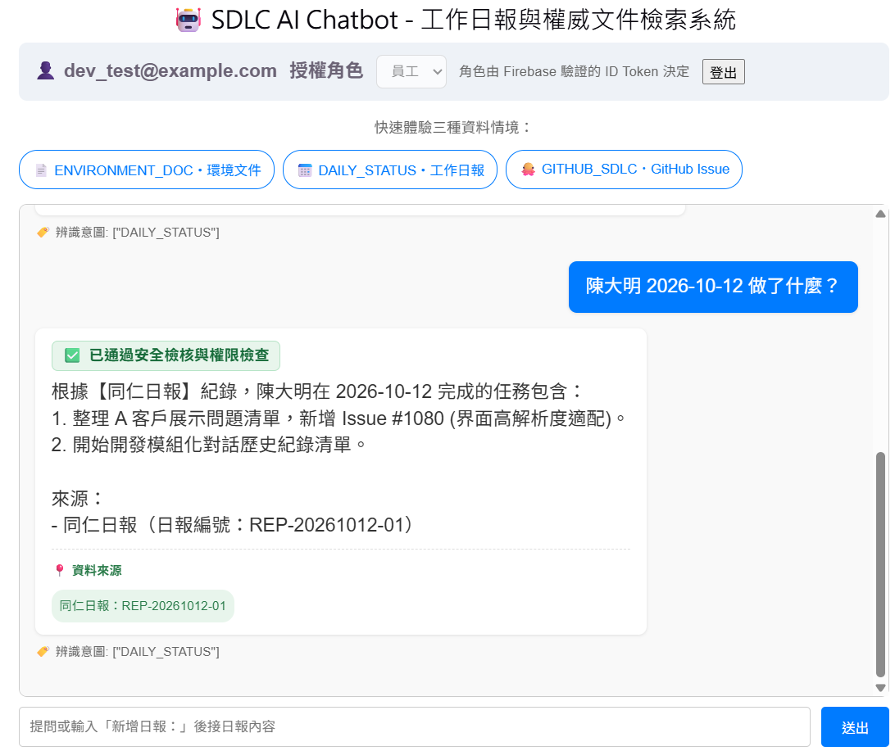
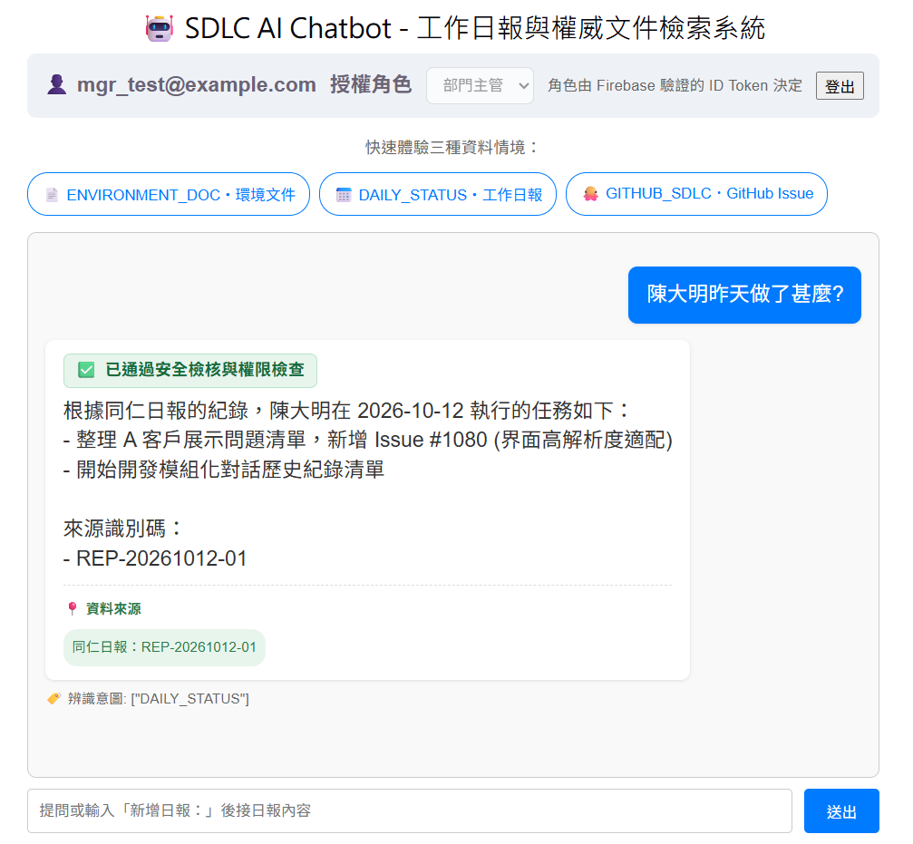

# 改動前基準（Baseline）

在開始 Step 1 之前，原本的 Chatbot 行為。之後每個 Step 完成後都與此對照。
測試帳號：員工 `DEVELOPER`、主管 `MANAGER`。

## 發現
1. **檢索不穩定**：同一題「陳大明昨天做了什麼？」，員工帳號第一次回答找不到，再問一次卻有答案；主管引用 10/12、員工引用 10/19，每次結果不同。
2. **模糊的時間詞沒有被解讀**：「昨天」沒有換算成實際日期，系統只是自行猜一個相對於日報的日期。
3. **「最近」並不準**：回答稱最近三筆為 10/12、10/16、10/19，但陳大明最後一筆日報是 10/22；系統是依文字相似度挑選，並沒有真正依日期排序。
4. **明確日期就穩定**：問「陳大明 2026-10-12 做了什麼？」可正確回答。
5. **權限不是原因**：`REP-20261012-01` 為 `DEVELOPER` 等級，員工本來就能存取；差異來自檢索（相似度門檻 0.55、LLM 挑選候選文件）。

→ 以 Step 1 的 SQL 欄位（日期、作者、進度）做精準查詢，可改善 2、3。

## 畫面
員工帳號，第一次（找不到）：

員工帳號，再問一次（引用 10/19）：

員工帳號，明確日期（答對）：

主管帳號（引用 10/12）：

