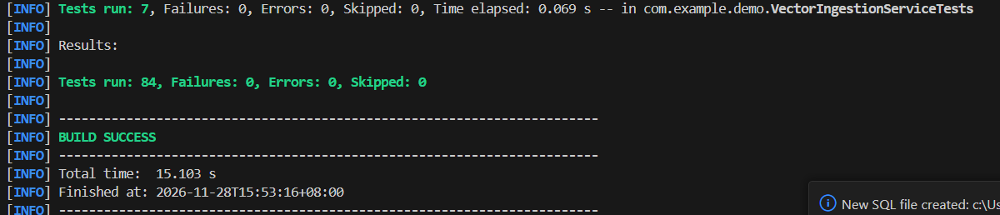

# 清理：移除舊版根目錄後端

## 做了什麼
`demo/` 是現行後端（搭配 `my-ai-ui/`），根目錄的舊版後端與不該進 repo 的檔案已移除（共 65 個檔案）：

- 舊版後端：`src/`、根目錄 `pom.xml`、`.mvn/`
- 編譯產物與 Node.js 執行檔：`target/`、`node.exe`、`npm*`、`npx*`、`corepack*`、`nodevars.bat`、`install_tools.bat`（`.gitignore` 本來就排除，只是規則加入前已被 commit）
- `scripts/evaluate-ground-truth.ps1`：`demo/scripts/` 版本的舊副本

保留：`demo/`、`my-ai-ui/`、`infra/`、`.github/`、`.azure/`、`docs/`、`scripts/firebase-admin/`、`node - project/`（用途待組員確認）。

## 驗證
清理後在 `demo/` 執行 `.\mvnw.cmd clean test`，84 個測試全部通過，前後端皆不受影響。

