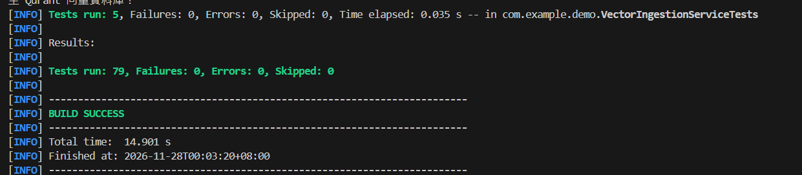
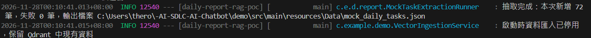
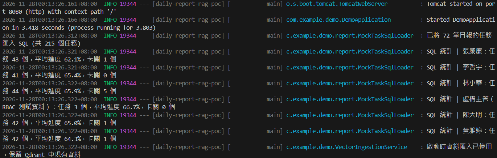
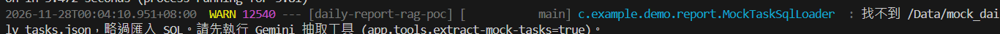

# Step 1b：Gemini 任務抽取 + 匯入 SQL

## 這次做了什麼
- `TaskExtractionService`：用 Gemini Structured Output 把一份日報拆成任務清單（進度 %、優先度、是否卡關、卡關說明），並驗證/修正 LLM 輸出（進度限制 0–100、空白任務名丟棄）。
- `MockTaskExtractionRunner`：一次性工具，對 72 筆範例日報抽取，結果存成 `Data/mock_daily_tasks.json`。可中斷續跑、已完成的不會重複呼叫 Gemini。
- `MockTaskSqlLoader`：啟動時把 JSON 匯入 SQL（不呼叫 Gemini），並在日誌印出每位作者的 SQL 統計。

## 執行抽取（只需做一次）
```powershell
cd demo
$env:GOOGLE_API_KEY = "<金鑰>"
$env:APP_INGESTION_ENABLED = "false"          # 避免重複寫入 Qdrant
$env:APP_TOOLS_EXTRACT_MOCK_TASKS = "true"
.\mvnw.cmd spring-boot:run
```
完成後日誌會顯示「抽取完成」，按 `Ctrl+C` 結束，並 commit `demo/src/main/resources/Data/mock_daily_tasks.json`。

## 匯入 SQL 並查看統計
```powershell
Remove-Item Env:APP_TOOLS_EXTRACT_MOCK_TASKS
$env:APP_INGESTION_ENABLED = "false"
.\mvnw.cmd spring-boot:run
```
日誌會出現「SQL 統計 | 作者：任務 N 個，平均進度 X%，卡關 Y 個」。

## 測試
`.\mvnw.cmd clean test`：79 個測試全部通過。



## 結果

Gemini 抽取 72 筆日報，失敗 0 筆：



匯入 SQL 後共 215 個任務，每位作者的統計由 SQL `GROUP BY` 計算：



> 補充：尚未產生 `mock_daily_tasks.json` 時啟動，匯入程式會略過並提示，屬預期行為：
>
> 

## 觀察
- 每份日報約為「2 個已完成 (100%) + 1 個明日計畫 (0%)」，因此各作者平均進度都落在 62–66%，**不適合直接當績效指標**（Step 4 需改用完成數、High 優先度解決數、卡關數）。
- 前一天的「明日計畫」隔天會以「已完成」再出現，同一任務在 SQL 內有多筆，需要 Step 2 的語意去重與進度追蹤。

## 尚未做（1c）
- 使用者在聊天視窗新增日報（`/api/v1/reports/ingest`）時，同步抽取任務並寫入 SQL。
