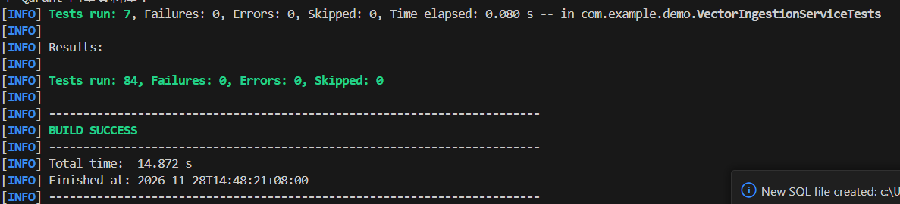
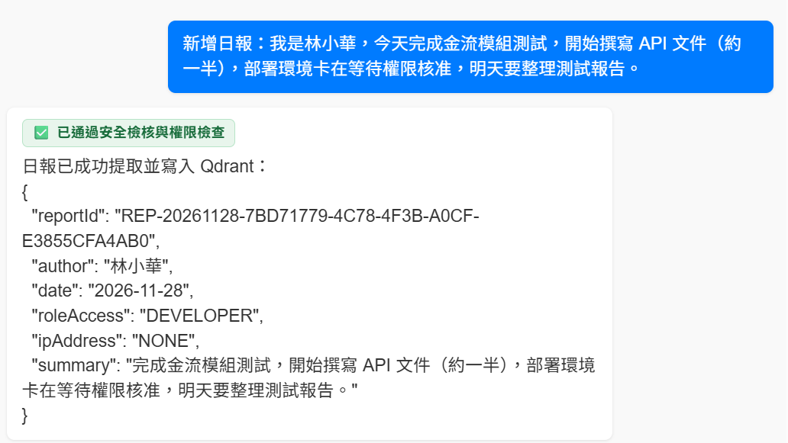

# Step 1c：新增日報時同步寫入 SQL

## 這次做了什麼
- 使用者在聊天視窗輸入「新增日報：…」（`/api/v1/reports/ingest`）時，日報寫入 Qdrant 之後，
  會再用 Gemini 抽取任務（進度 %、優先度、卡關）並寫入 SQL。
- `ReportTaskRecorder` 負責抽取＋寫入；以選擇性注入掛在 `VectorIngestionService`，原有建構子與測試不變。
- 任務抽取或寫入 SQL 失敗時只記警告，不影響日報已寫入向量庫。
- 以 `report_id` 覆寫，重複送出不會產生重複任務。

## 測試
`.\mvnw.cmd clean test`：新增 5 個測試，總數 84 個全部通過。

> 測試中的 `DemoApplicationTests` 已固定 `app.ingestion.enabled=true`，不再受開發者終端機裡 `APP_INGESTION_ENABLED` 的影響。

## 實際操作驗證
1. 啟動後端（`APP_INGESTION_ENABLED=false`）與前端，用員工帳號登入。
2. 在聊天視窗輸入，例如：

   `新增日報：我是林小華，今天完成金流模組測試，開始撰寫 API 文件（約一半），部署環境卡在等待權限核准，明天要整理測試報告。`

3. 後端日誌會出現：`日報 REP-… 已將 N 個任務寫入 SQL：任務名稱(進度%, 優先度, 卡關)…`

## 實際操作結果
聊天視窗輸入範例日報後，系統成功整理並寫入 Qdrant：

後端日誌顯示同一份日報（`REP-20261128-7BD71779-…`）抽取出 4 個任務並寫入 SQL：

| 日報內容 | 進度 | 優先度 | 卡關 |
|---|---|---|---|
| 完成金流模組測試 | 100% | HIGH | 否 |
| 撰寫 API 文件（約一半） | 50% | LOW | 否 |
| 部署環境（等待權限核准） | 0% | HIGH | 是 |
| 整理測試報告（明天） | 0% | MEDIUM | 否 |

> 注意：用 Windows PowerShell 5.1 的 `Tee-Object` 存日誌會把中文存成亂碼，截圖請直接取自後端終端機畫面。
