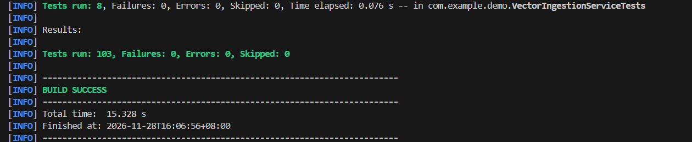

# Step 2a：交接摘要 API（後端）

## 這次做了什麼
- `GET /api/v1/handover/summary`：給作者與日期區間，回傳任務狀態分布與依優先度（或進度）排序的待辦清單。所有數字由 SQL / 程式計算，不經過 LLM。
- **任務去重（刻意保守）**：交接時漏掉任務比多顯示一個重複更糟。去除空白標點與開頭的狀態動詞（完成、進行、開始…）後，符合「完全相同」、「較短名稱（≥6 字）完整包含在較長名稱內」、「字元二連詞 Jaccard ≥ 0.8」任一條件才合併，並保留最新日報的狀態與出現次數。例如前一天的「進行 GCP 雲端成本盤點（0%）」隔天變「完成 GCP 雲端成本盤點（100%）」會合併成一筆 DONE。
  - 設計過程：最初用 Jaccard ≥ 0.5，單元測試就發現「低優先度進行中任務」與「中優先度進行中任務」被誤合併；拿 215 個真實任務模擬，0.5 會合併 5 組、其中約 3 組是不同任務（例如「搭建 GitHub MCP Server」與「GitHub MCP Server 權限」，或把 5 個不同的 Prompt Injection 任務串成一組）。改成現行規則後，真實資料只合併 2 組，且都是真正的重複。
- **狀態分類**：DONE（100%）、IN_PROGRESS（1–99%）、BLOCKED（卡關且未完成）、NOT_STARTED（0%）。
- **權限**：員工只能查自己，且只看 DEVELOPER / PUBLIC 等級日報；主管可查任何人，且可看 MANAGER 等級日報。與 Qdrant 的篩選規則一致。
- **作者以登入帳號為準**：新增 `user_authors` 對應表（Firebase email → 作者姓名，範例見 `Data/user_authors.json`）。聊天視窗新增日報時，作者不再由 Gemini 從文字猜，避免用 A 的帳號輸入「我是 B…」記在 B 名下。
- `SecurityConfig` 開放 `/api/v1/handover/**`（DEVELOPER / MANAGER）並允許 GET。

## 帳號對應（請依實際測試帳號調整）
| 登入帳號 | 對應作者 |
|---|---|
| dev_test@example.com | 林小華 |
| mgr_test@example.com | 黃雅婷 |

## 測試
`.\mvnw.cmd clean test`（新增約 20 個測試）。最終結果：**103 個測試，0 失敗、0 錯誤**。

> 過程中第一次跑是 102 個測試、1 個失敗：排序測試的任務名稱太像被去重誤合併。這也促成了上面「保守去重」的改版。

## 實際畫面
2a 只有後端 API，畫面驗證在 2b（前端圖表）進行。
