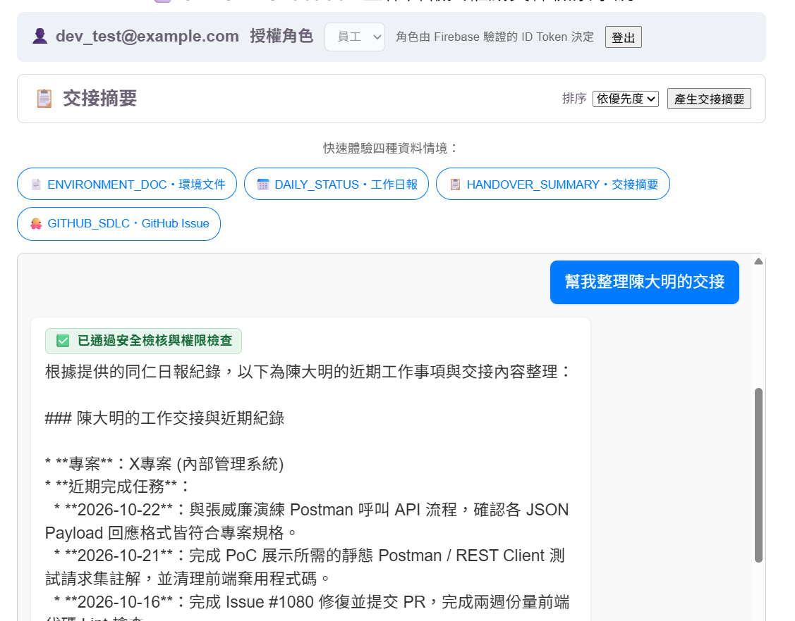
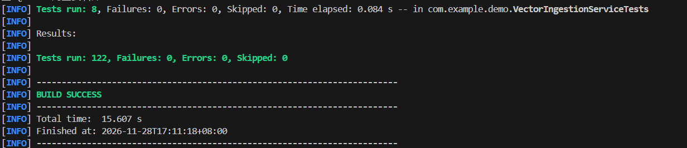
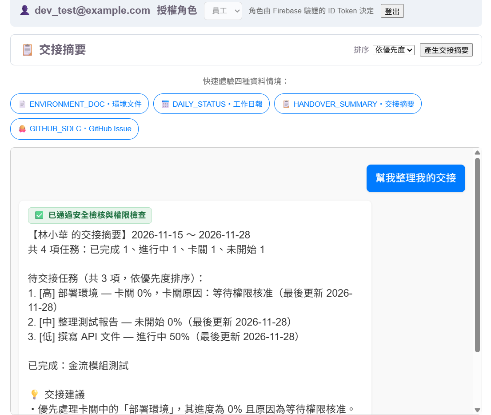
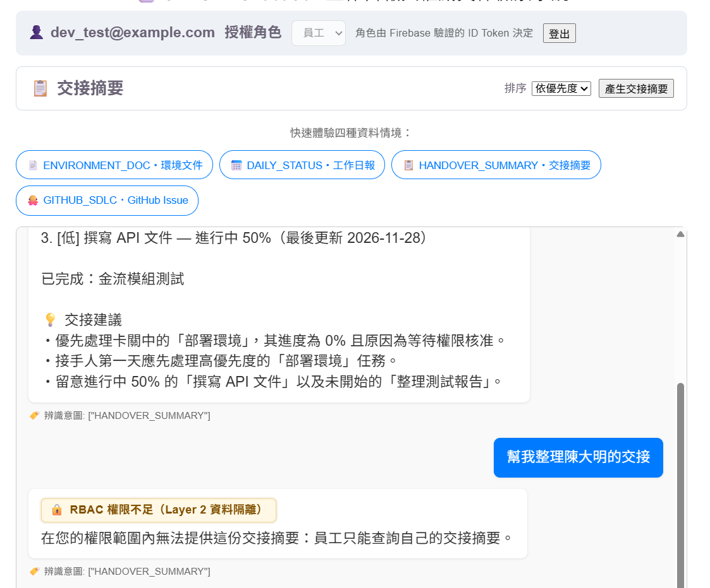
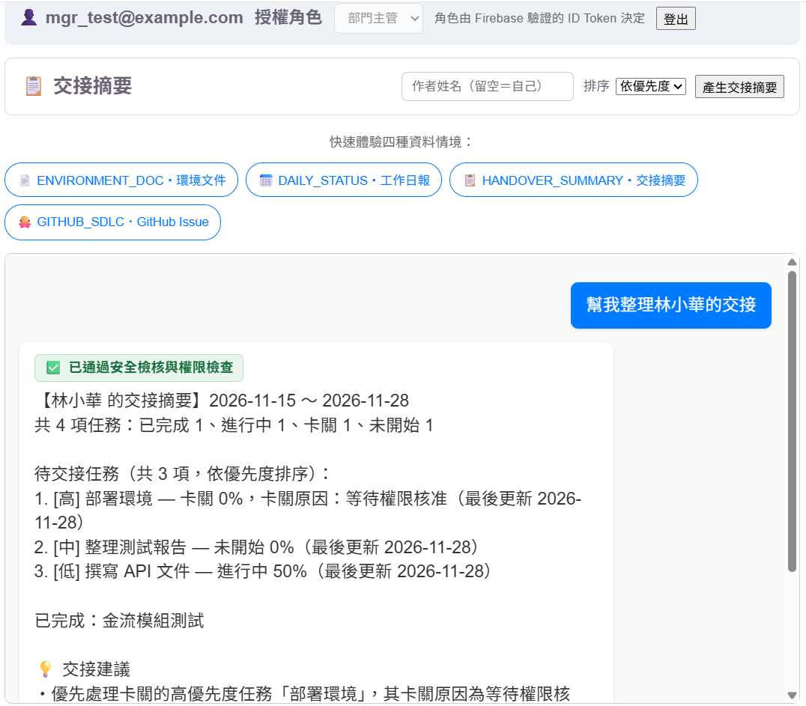

# Step 2c：聊天視窗的交接摘要（Supervisor 意圖路由）

## 這次做了什麼
在聊天視窗直接問「幫我整理我的交接」、「整理林小華的交接」，系統會判斷這是交接需求，改走 SQL 統計，不再走 Qdrant 向量檢索。

流程：
1. Layer 1 Guardrail（Prompt Injection 檢查，原有）。
2. **意圖分類**：`IntentCategory` 新增 `HANDOVER_SUMMARY`，由 `LlmIntentClassifier` 的提示詞判斷（「整理交接 / 列出待辦 / 統計任務狀態」才算；詢問「某天日報寫了什麼」仍是 `DAILY_STATUS`）。
3. **`HandoverChatHandler`** 從問題中比對資料庫裡的作者姓名（沒提到人名＝查自己），呼叫 2a 的 `HandoverService`（Layer 2：員工只能查自己，主管可查任何人）。
4. **事實由程式產生**：任務數量、狀態分布、待交接清單、卡關原因全部由 SQL 結果排版，不經過 Gemini。
5. **Gemini 只補「💡 交接建議」**：只收到上面那段已定案的摘要，被要求不得新增或修改任何數字與任務，且摘要視為資料而非指令。Gemini 失敗時仍會回傳完整的 SQL 統計，只是沒有建議。
6. 這一輪對話會寫入對話記憶，之後可以接著追問。

權限被擋時（例如員工問「整理陳大明的交接」）會回覆 `RBAC_DENIED`，也不會呼叫 Gemini。

## 實測發現與修正
第一版只靠 Gemini 分類，實際測試時 119 個單元測試全過，但畫面上三句交接問題都沒走到 SQL 摘要：
- 員工問「幫我整理我的交接」→ 被判成 `GENERAL_CHAT`，只得到一段客套回覆。
- 員工問「幫我整理陳大明的交接」→ 被判成 `DAILY_STATUS`，走向量檢索，回了日報原文。
- 主管問「幫我整理林小華的交接」→ 同樣被判成 `DAILY_STATUS`。

原因：單元測試把分類器換成假的，測不到真實 Gemini 的判斷。修正方式是新增 `HandoverIntentRules`：「整理/列出/給我…交接」、「交接摘要」、「待交接」、「未完成任務」這類固定句型先用規則判斷，命中就直接走交接摘要（也省一次 Gemini 呼叫）；沒命中才交給 LLM。「請假交接」、「開立交接 Issue」屬於既有工單流程，刻意排除。

修正前（員工問陳大明，走到日報檢索並回了日報原文）：

> 注意：修正後須**重啟後端**才會生效；`mvnw test` 不會更新已在執行的後端。

## 設計取捨
- 作者姓名用資料庫比對，不讓 LLM 從句子猜人名，避免猜錯人導致看到別人的資料。
- 沒有指定區間，一律用 2a 的預設（最新日報往前 14 天）；之後可再加「上週」「這個月」等時間詞。
- 聊天視窗只列前 10 項待交接任務，完整清單與甜甜圈圖仍看上方面板。
- 前端新增「📋 HANDOVER_SUMMARY・交接摘要」快速體驗按鈕。

## 測試
新增 `HandoverChatHandlerTests`（人名辨識、排版、截斷、Gemini 失敗、員工查別人被擋且不呼叫模型、主管未指定對象…），並補上 `ChatAssistantServiceTests`（意圖路由、權限狀態傳遞、Prompt Injection 仍先被攔截）、`LlmIntentClassifierTests`、`DailyReportSqlRepositoryTests`。

驗證指令：`.\mvnw.cmd clean test`。最終結果：**122 個測試，0 失敗、0 錯誤**。

## 實際畫面
**員工問自己**：標頭、數量、待交接清單由 SQL 產生，最後是 Gemini 的交接建議；意圖標籤為 `HANDOVER_SUMMARY`。

**員工問別人**：被 Layer 2 擋下，顯示「RBAC 權限不足」，沒有呼叫 Gemini。

**主管問林小華**：與員工看到的數字一致。

